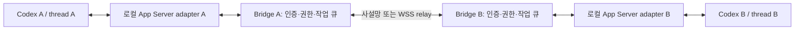

# 아키텍처 결정

## 현재 제품 결정 (2026-10-30 후속 지시)

두 모드로 구분한다. security mode는 기존 사내 SSH를 이용하는 영속 mailbox + MCP 도구로
구현한다. comfort mode는 Tailscale 기반 편의 연결을 위한 예약 옵션이며 이번 범위에서는
구현·설치하지 않는다. OpenAI-only relay 목표는 현재 제품 구현 경로에서 제외하고 조사 기록만 보존한다.
[Security mode 가이드](security-mode.ko.md)를 우선 적용한다. 아래 비교와 OpenAI 조사 우선순위는
이전 의사결정의 기록이며 현재 지시보다 우선하지 않는다.

## 대안 비교

| 대안 | 장점 | 단점 | 판단 |
|---|---|---|---|
| OpenAI Remote Control relay 재사용 | 기존 NAT 접근 인프라 | 외부 A2A 클라이언트 공개 계약 미확인, 계정·인증 종속 | 우선 검증, client 계약 미확인 |
| Tailscale 등 사설망 + 호스트별 Bridge + 로컬 App Server | 공인 IP·포트 포워딩 없이 연결 가능하도록 구성 가능, 개발 범위 작음 | 사설망 가입·ACL 설정 필요, 환경별 검증 필요 | 초기 대안, 현재 우선순위 아님 |
| 자체 WSS relay + 호스트별 outbound Bridge | 양쪽 모두 outbound, agent ID 기반 라우팅, 사설망 제품 의존 감소 | relay 운영, 인증·저장·재전송·용량 제한 구현 필요 | 대안, 현재 우선순위 아님 |

## 현재 우선순위: OpenAI 클라우드 경로 검증

2026-10-30 사용자 결정: **양쪽 서버가 OpenAI 클라우드로 outbound 연결하고,
상대 주소·포트 개방·Tailscale 설치 없이 pairing code만으로 연결**하는 경로를 우선 검증한다.
위 표의 사설망 권장은 초기 대안 비교 기록이다. 현재 구현 방향은 Tailscale/SSH/자체 relay로
대체하지 않으며, 해당 대안으로 목표를 달성했다고 판정하지 않는다.

호스트 측 등록·코드 발급과 원격 제어 클라이언트 측 코드 수락·접속을 각각 검증한다.
둘 다 호스트로 relay에 등록되는 것만으로 서로 통신할 수 있다고 가정하지 않는다.
`cloud-inspect`와 `cloud-probe`는 이 경로를 위한 진단이다. 구체적인 결과와 남은
클라이언트 경로는 [클라우드 검증 기록](cloud-research.ko.md)과 [후속 조사](relay-followup.ko.md)을 따른다.

아래 그림은 전송 계층을 분리한 초기 설계이다. 공식 OpenAI relay를 사용하려면
Bridge가 사용할 수 있는 클라이언트 계약이 확인되어야 하며, 현재 확인되지 않았다.

MCP는 Codex가 Bridge에 작업을 요청하고 결과를 조회하는 도구 면이다.
수신 push는 별도 worker가 로컬 허용 정책과 승인 상태를 확인한 뒤 해당 thread의 큐에 넣는다.
MCP만 등록해도 실행 중인 TUI에 자동으로 push되는 것은 아니다.
긴 작업의 MCP 호출은 task ID를 즉시 반환해야 한다. 결과를 기다리며 turn을 계속 점유하면
A→B→A 재귀 요청에서 교착될 수 있다.

## 작업 모델 (설계, 아직 미구현)

Envelope: protocol version, message ID, task ID, parent task ID, from/to agent ID,
타임스탬프, 만료, nonce, payload, 인증 정보. task ID와 message ID는 구분한다.
메시지 유형은 원본 요구사항의 8종을 유지한다.

상태는 requested → accepted → running → completed/failed이며 progress는 terminal 상태가 아니다.
인증된 송신자와 task 소유권을 확인하고 중복 message ID와 불법 상태 전이를 거부한다.
서명 만료+nonce+영속 deduplication으로 재전송 공격을 막고, 재연결 시 ack와 미완료 큐를 복구한다.
정확히 한 번 실행을 일반적으로 보장한다고 주장하지 않고 task handler의 멱등성을 설계한다.

## 권한과 파일 전송

호스트별 stable agent ID와 허용 peer 목록을 유지한다. relay의 주소 정보와 agent 신원은 분리한다.
TLS/mTLS 또는 검증된 메시지 서명, 짧은 등록 코드, 갱신·폐기 가능한 장기 키를 사용한다.
비밀은 저장소 밖의 권한 제한 저장소에 둔다. 현재 PoC에는 peer나 키 저장이 없다.

원격 자연어를 사용자 명령으로 그대로 실행하지 않는다. 허용된 operation과 workspace만
호스트 소유자가 지정하고, 원격 내용은 비신뢰 입력으로 전달하며 권한은 로컬 정책으로 강제한다.
프롬프트에 경고문을 붙이는 것만으로 권한 경계가 생기지는 않는다.
위험 작업은 로컬 승인으로 승격하고, 원격 peer가 approval/sandbox 설정을 고르지 못하게 한다.

파일은 별도 data plane에서 스트리밍한다. export/import root, 경로 정규화·symlink 탈출 방지,
디렉터리 manifest, chunk offset·재시도·이어받기, 크기 한도·quota, SHA-256 최종 검증 후
원자적 publish가 필요하다. 파일 본문은 LLM 컨텍스트에 넣지 않는다.
감사 기록에는 task ID·peer·권한 결정·상태·파일 해시를 남기고 토큰과 민감한 본문은 제거한다.

## 우선순위 및 완료 기준

1. **현재:** 로컬 실제 두 프로세스/thread, 양방향 hello, 컨텍스트 유지 검증.
2. 기존 daemon의 별도 테스트 TUI thread를 명시적으로 연결해 idle/busy queue와 완료 이벤트를 검증.
3. 두 호스트에서 인증된 Bridge + task 상태·재전송 방지·영속 큐 구현. 각 호스트 실제 Codex가 처리해야 MVP 통과.
4. MCP request/status/reply 도구와 비동기 응답 반영. 명시적으로 허용된 작업 디렉터리 파일 목록 예제 추가.
5. 파일 전송, 중단/재접속, 대용량·디렉터리·권한 회귀 테스트.
6. 자체 relay adapter, pair/connect UX, opt-in MCP 등록.

2~6은 계획이며 현재 구현된 기능이 아니다. 특히 파일 목록을 Python이 대신 읽어서
Codex가 조사한 것처럼 보고하거나, 단일 세션 원격 제어로 MVP를 대체하지 않는다.
